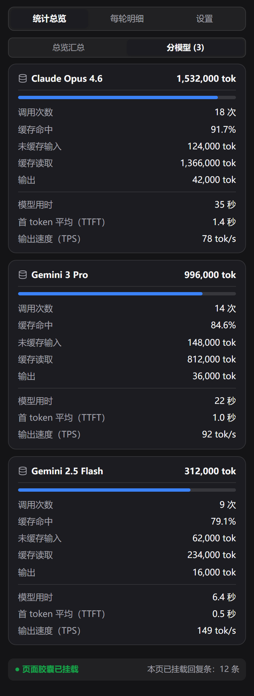
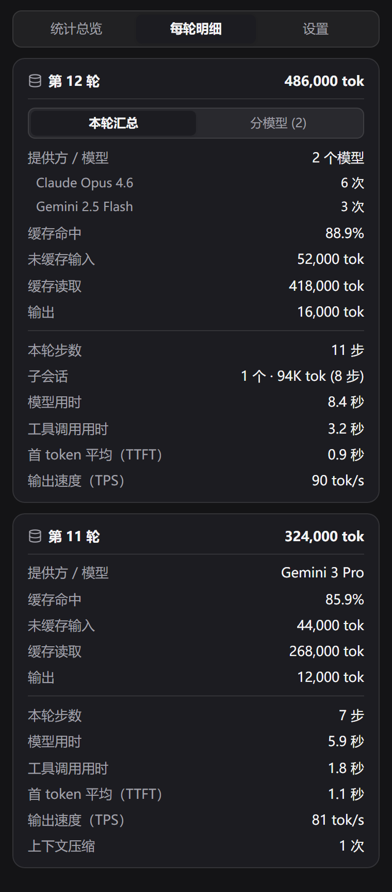

# AGY监控

Antigravity 会话统计、分模型缓存命中分析、上下文占用拆解、每轮用量胶囊与额度监控插件。

---

## 核心功能

- **底部三枚监控胶囊**
  - 在聊天输入框下方常驻展示：**会话轮步与输出速度（TPS）**、**Token 总量与缓存命中率**、**上下文占用环形进度条**；
  - 支持 **悬停预览**、**点击固定浮层**、鼠标移开自动收起及按 `Esc` / 点击空白处关闭。
- **每轮用量胶囊**
  - 自动挂载到每条已完成回复的操作栏右侧（`用量 XXX tok`）；
  - 展示该轮调用模型列表、缓存命中率、Token 构成、步数、子会话摘要、模型用时、工具调用用时、首 token 平均耗时（TTFT）、输出速度（TPS）及上下文压缩次数。
- **分模型二级栏核算**
  - 在底部浮层、每轮浮层和侧边栏均提供「汇总 / 分模型」二级栏切换；
  - 针对多模型混用或主/子会话切换不同模型的场景，按模型独立核算调用次数、缓存命中率、未缓存输入/缓存读取/输出 Token、耗时、TTFT 与 TPS。
- **子会话递归监控与上下文压缩统计**
  - 自动追踪并递归聚合嵌套子会话的 Token 与步数，汇总至主会话总量及对应触发轮次，并在侧边栏独立列出子会话明细；
  - 记录并展示会话及单轮触发上下文压缩的次数，精确拆分当前上下文窗口与历史压缩分段。
- **上下文窗口构成拆解**
  - 通过彩色分段进度条直观展示当前上下文窗口中 **对话消息、工具定义、系统提示词、Skills、Mcp Tools** 等类别的占用体积。
- **右侧「AGY监控」侧边栏与个性化设置**
  - 内置「统计总览 / 每轮明细 / 设置」三大视图与模型配额池监控；
  - 支持独立开关底部监控栏、每轮用量胶囊、侧边栏配额展示，支持 **简体中文 / English** 一键切换。

---

## 图片展示

> 以下图片均基于插件真实界面与示例数据渲染展示。

### 底部监控胶囊 & 分模型 Token 浮层


### 每轮用量胶囊 & 单轮详情浮层


### 右侧「AGY监控」侧边栏

| 统计总览 · 汇总 | 统计总览 · 分模型 | 每轮明细 |
| :---: | :---: | :---: |
|  |  |  |

---

## 一键安装与更新

### 1. 环境准备
- 已安装 **Google Antigravity**
- 已安装 **Node.js**（22.13+）及 **Git**

### 2. 克隆与安装
```powershell
git clone https://github.com/<你的用户名>/agy-monitor.git
cd agy-monitor
powershell -NoProfile -ExecutionPolicy Bypass -File .\install.ps1
```

脚本会自动完成以下全部步骤：
1. 将插件安装/更新到 `%USERPROFILE%\.gemini\config\plugins\agy-monitor`（若已有旧版会自动备份至 `./backups/`）；
2. 自动配置桌面及开始菜单中的 `Antigravity` 快捷方式以启用页面监控挂接；
3. 自动运行 `node --test` 单元测试验证插件可用。

> 安装完成后，请通过桌面或开始菜单中的 `Antigravity` 快捷方式**完全退出并重启一次 Antigravity** 即可生效。

---

## 本地单元测试与目录说明

- **运行单元测试**：
  ```powershell
  node --test .\plugin\test\telemetry.test.mjs
  ```
- **实时插件目录（仅本地）**：`%USERPROFILE%\.gemini\config\plugins\agy-monitor`
- **插件设置文件（仅本地）**：`%USERPROFILE%\.gemini\config\plugins\agy-monitor\settings.json`
