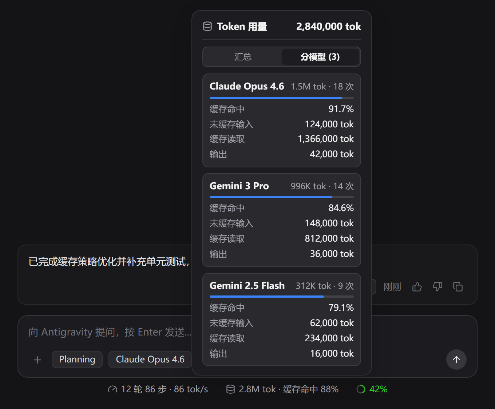
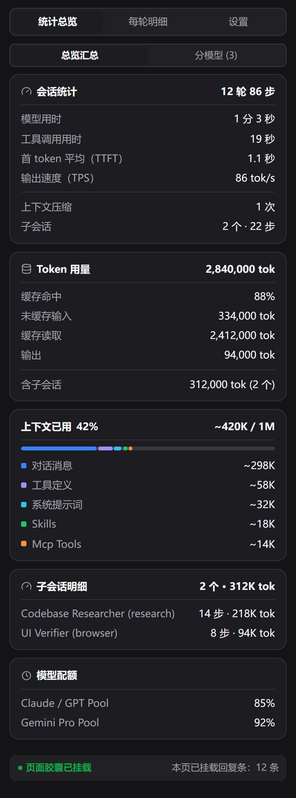

# AGY监控

Antigravity 会话统计、分模型缓存命中分析、上下文占用拆解、每轮用量胶囊、历史 Token 用量统计与额度监控插件。

---

## 核心功能

- **底部监控胶囊**
  - 在聊天输入框下方常驻展示：**会话轮步与输出速度（TPS）**、**Token 总量 / 缓存命中率 / 缓存过期状态**、**上下文占用环形进度条**，以及自动匹配当前模型池的 **模型配额余量（`5h` / `周`）**；
  - 缓存过期默认按官方口径（Claude 5 分钟、GPT-5.6+ 30 分钟、Gemini 隐式 5 分钟热区参考，支持手动预设 `5m / 10m / 30m / 1h`）展示**剩余倒计时**，支持切换为**已过时间**或关闭，并在本地秒级刷新不额外触发 CDP 推送；
  - 支持 **悬停预览**、**点击固定浮层**、鼠标移开自动收起及按 `Esc` / 点击空白处关闭。
- **每轮用量胶囊**
  - 自动挂载到每条已完成回复的操作栏右侧（`用量 XXX tok`）；
  - 展示该轮调用模型列表、缓存命中率、Token 构成、步数、子会话摘要、模型用时、工具调用用时、首 token 平均耗时（TTFT）、纯流式输出速度（TPS，剔除首 token 等待）及上下文压缩次数。
- **分模型二级栏核算**
  - 在底部浮层、每轮浮层和侧边栏均提供「汇总 / 分模型」二级栏切换；
  - 针对多模型混用或主/子会话切换不同模型的场景，按模型独立核算调用次数、缓存命中率、未缓存输入/缓存读取/输出 Token、耗时、TTFT 与 TPS。
- **子会话递归监控与上下文压缩统计**
  - 自动追踪并递归聚合嵌套子会话的 Token 与步数，汇总至主会话总量及对应触发轮次，并在侧边栏独立列出子会话明细；
  - 记录并展示会话及单轮触发上下文压缩的次数，精确拆分当前上下文窗口与历史压缩分段。
- **上下文窗口构成拆解**
  - 通过彩色分段进度条直观展示当前上下文窗口中 **对话消息、工具定义、系统提示词、Skills、Mcp Tools** 等类别的占用体积（总占用取服务端实测，分类拆解附带客户端估算提示）。
- **历史 Token 用量统计（用量统计 Tab）**
  - 支持 **本日 / 本周 / 本月 / 全部** 四档时间切换，提供 **5 级纯色月历**、年度热力图、柱状图与日期/小时下钻交互；
  - 自动避免主/子会话重复计入，统计缓存命中率、思考/正文输出占比（自动识别未上报思考拆分的模型并提示）、等效费用与缓存节省估算，并按模型独立汇总调用次数、TTFT 与纯流式 TPS；
  - 历史数据库扫描与缓存持久化运行在独立 **Worker 线程** 中，使用单读事务 SQLite WAL 快照与本地时区感知缓存，常规刷新自动保留已删除会话的历史归档（点击重建时清空），不阻塞实时遥测接口与页面心跳。
- **右侧「AGY监控」侧边栏与个性化设置**
  - 内置 **「统计总览 / 每轮明细 / 用量统计 / 设置」四大视图**；「模型配额」卡片置顶显示于总览顶部，高亮当前使用模型池，并按 **`5h` 与 `周` 双窗口**展示进度条、剩余比例与重置倒计时；「Token 用量」卡片同步显示缓存过期状态并支持一键切换倒计时/已过时间；
  - 支持独立开关底部监控栏、底部配额胶囊、缓存过期显示模式与 TTL 参考预设、每轮用量胶囊、侧边栏配额与费用估算展示，支持 **简体中文 / English** 一键切换，并自适应宿主的深/浅色主题。
- **低开销常驻与稳定性**
  - 实时会话快照采用单遍线性扫表与二分定位，注入器将观察范围收敛至聊天容器并在排序前缓存布局坐标，同时对连续超时的 CDP 连接做退避回收；
  - 侧边栏采用 `AbortController` 超时控制、请求单飞锁、页面隐藏自动暂停轮询及零重排悬浮 Tooltip。

---

## 图片展示

> 以下图片均基于插件真实界面与示例数据渲染展示。

### 底部监控胶囊 & 分模型 Token 浮层



### 每轮用量胶囊 & 单轮详情浮层


### 右侧「AGY监控」侧边栏

| 统计总览 · 汇总 | 统计总览 · 分模型 | 每轮明细 | 用量统计 |
| :---: | :---: | :---: | :---: |
|  |  |  |  |

---

## 一键安装与更新

### 1. 环境准备
- 已安装 **Google Antigravity**
- 已安装 **Node.js**（22.13+）及 **Git**

### 2. 克隆与安装
```powershell
git clone https://github.com/imfateone/agy-monitor.git
cd agy-monitor
powershell -NoProfile -ExecutionPolicy Bypass -File .\install.ps1
```

默认安装（`install.ps1` 适用于 Windows）会自动完成以下步骤：
1. 将插件安装/更新到 `%USERPROFILE%\.gemini\config\plugins\agy-monitor`（若已有旧版，自动备份至 `./backups/`）；
2. 运行 `node --test` 单元测试验证插件可用；
3. 仅针对当前用户桌面、开始菜单、任务栏中**直接指向 `Antigravity.exe`** 的快捷方式，原地追加 `--remote-debugging-port=0` 以启用底部监控栏和每轮用量胶囊：
   - 修改前自动备份原 `.lnk` 至 `./backups/`；
   - **完整保留原有代理等其他参数、已有有效调试端口、图标和工作目录等设置**；
   - 若原入口为自定义代理脚本/启动器（非 `Antigravity.exe`），**保持原样不修改**，并提示透传方法。

> 安装完成后，请**完全退出并重新启动 Antigravity**，即可同时使用右侧 AGY监控 面板与底部/每轮用量胶囊。
>
> **macOS / Linux**：将 `./plugin` 复制到 `~/.gemini/config/plugins/agy-monitor`，运行 `node --test ~/.gemini/config/plugins/agy-monitor/test/telemetry.test.mjs` 验证后完全重启 Antigravity；如需底部监控栏和每轮用量胶囊，请在启动命令中传入 `--remote-debugging-port=0`。

### 3. 自定义启动入口与高级安装选项

- **不想改动任何快捷方式（仅装右侧面板，或自行管理启动参数）**：
  ```powershell
  powershell -NoProfile -ExecutionPolicy Bypass -File .\install.ps1 -NoShortcut
  ```
- **保留原有快捷方式，另建桌面独立监控入口（系统级公共桌面安装时也适用）**：
  ```powershell
  powershell -NoProfile -ExecutionPolicy Bypass -File .\install.ps1 -CreateMonitorShortcut
  ```
  安装器不修改已有快捷方式，并在当前用户桌面新建 `Antigravity (AGY Monitor)`。
- **使用自定义代理脚本 / 手动配置原入口**：
  - 若通过自定义脚本启动，请让原脚本把 `--remote-debugging-port=0` 透传给 `Antigravity.exe`；
  - 若手动修改快捷方式：右键快捷方式 →「属性」→ 在「目标」栏末尾加一个空格再加 `--remote-debugging-port=0`（程序路径带引号时放在引号外，保留原有其他参数）→ 完全退出并重启 Antigravity。

---

## 本地单元测试与目录说明

- **运行单元测试**：
  ```powershell
  node --test .\plugin\test\telemetry.test.mjs
  ```
- **实时插件目录（仅本地）**：`%USERPROFILE%\.gemini\config\plugins\agy-monitor`
- **插件设置文件（仅本地）**：`%USERPROFILE%\.gemini\config\agy-monitor\settings.json`
- **历史用量缓存文件（仅本地）**：`%USERPROFILE%\.gemini\config\agy-monitor\usage-stats-cache.json`
